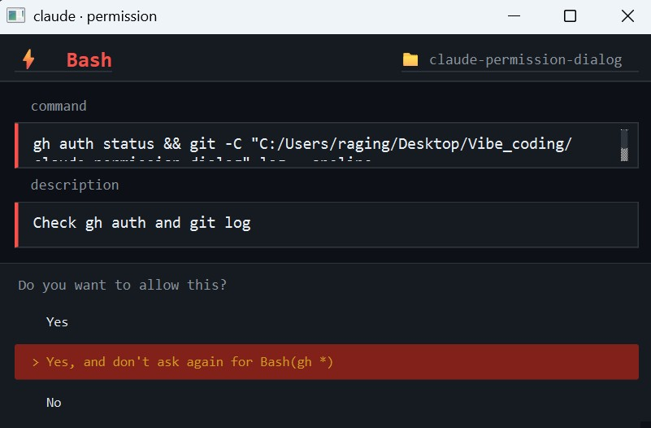

# claude-permission-dialog

**English** | [中文](#中文)

---

A terminal-style permission dialog for [Claude Code](https://claude.ai/code) on Windows.

Replaces the built-in terminal permission prompt with a floating PyQt6 window — keyboard-driven, dark-themed, and project-aware. Also plays a 🎉 sound when Claude finishes a task.



## Features

- **Dark terminal UI** — Consolas font, colour-coded by tool type (red for Bash, yellow for Edit/Write)
- **Project-aware** — shows which folder the request is coming from
- **Keyboard navigation** — `↑ ↓` to move, `Enter` to confirm, `Esc` to deny
- **`>` cursor indicator** — highlights the currently selected option like a CLI prompt
- **Allow Similar** — skip future dialogs matching the same pattern (e.g. `Bash(git *)`)
- **Re-flashes every 30s** if ignored — nobody answering is a denial (after 50 minutes), never an approval
- **Tada sound** — plays `tada.wav` when Claude finishes a task

## Requirements

- Windows 10 / 11
- Python 3.10+
- Claude Code CLI

## Install

```powershell
git clone https://github.com/allenphant/claude-permission-dialog
cd claude-permission-dialog
powershell -ExecutionPolicy Bypass -File install.ps1
```

Restart Claude Code after installing.

## Keyboard Shortcuts

| Key | Action |
|-----|--------|
| `↑` `↓` | Move between options |
| `Tab` | Move down |
| `Enter` / `Space` | Confirm selected option |
| `Esc` | Deny |

## Options

| Option | Description |
|--------|-------------|
| **Yes** | Allow this one request |
| **Yes, and don't ask again for `[pattern]`** | Save pattern to allowlist, skip future matching requests |
| **No** | Deny the request |

## Allow Similar

Selecting the second option saves a pattern like `Bash(git *)` or `Edit(/path/to/project/*)` to `~/.claude/permission_allowlist.json`. Future requests matching that pattern skip the dialog entirely.

A saved rule is deliberately narrow:

- A `Bash(word *)` rule only covers **one simple command** that starts with that word. A command that chains or redirects (`;`, `&`, `|`, a newline, `` ` ``, `$(`, `>`, `<`) always asks, even when it starts with a saved word.
- No rule is offered for shells and interpreters (`bash`, `python`, `node`, `powershell` ...), `cd`, `curl`, `ssh`, `rm`, `sudo` and similar, nor for commands that start with a path or an `NAME=value`. Those requests show only Yes / No.
- A file rule covers files **inside** the directory after `..` and symlinks are resolved, and never the allowlist, `permission_dialog.py` or `~/.claude/settings*.json` themselves.

To reset the allowlist:

```powershell
echo {} > $env:USERPROFILE\.claude\permission_allowlist.json
```

## Hooks Installed

| Event | Action |
|-------|--------|
| `PreToolUse` (Bash, Edit, Write, MultiEdit) | Shows permission dialog |
| `Stop` | Plays `tada.wav` when Claude finishes |

## Uninstall

```powershell
powershell -ExecutionPolicy Bypass -File uninstall.ps1
```

Removes both hooks, the script, and the allowlist from `~/.claude/`.

## How It Works

```
Claude wants to run Bash
  → PreToolUse hook fires
    → permission_dialog.py reads tool JSON from stdin
      → dialog appears (in a child process, up to 50 minutes)
        → user presses Enter (allow) or Esc (deny)
          → allow: a `permissionDecision: allow` answer, exit 0
          → anything else — deny, no answer, a crash, a missing PyQt6, bad input: exit 2

Claude finishes task
  → Stop hook fires
    → tada.wav plays
```

Claude Code lets a tool run when a hook ends with any exit code other than 2 or times out, so the script fails **closed** and the installer gives the hook a 3600 s timeout (longer than the dialog's 3000 s). It no longer adds `Bash(*)`-style rules to `permissions.allow` (and removes the ones older versions added): approval is the hook's own decision. Run the tests with `python -m unittest test_security` (no PyQt6 needed).

---

# 中文

**[English](#claude-permission-dialog)** | 中文

---

一個為 Windows 上的 [Claude Code](https://claude.ai/code) 設計的終端機風格權限確認視窗。

取代內建的終端機 permission prompt，改以浮動的 PyQt6 視窗顯示 — 支援鍵盤操作、深色主題、並顯示當前專案路徑。Claude 完成任務時也會播放 🎉 音效。

## 功能

- **深色終端機 UI** — Consolas 字體，依工具類型顯示顏色（Bash 紅色、Edit/Write 黃色）
- **顯示專案位置** — 讓你清楚知道這個請求來自哪個資料夾
- **鍵盤操作** — `↑ ↓` 移動選項，`Enter` 確認，`Esc` 拒絕
- **`>` 游標指示** — 仿 CLI 的方式標示目前焦點選項
- **Allow Similar** — 儲存 pattern（如 `Bash(git *)`），之後相同類型的請求直接跳過確認
- **30 秒重新閃出** — 若忽略視窗，30 秒後自動重新浮出；沒人回應（50 分鐘後）視為拒絕，絕不自動核准
- **完成音效** — Claude 完成任務時播放 `tada.wav`

## 系統需求

- Windows 10 / 11
- Python 3.10+
- Claude Code CLI

## 安裝

```powershell
git clone https://github.com/allenphant/claude-permission-dialog
cd claude-permission-dialog
powershell -ExecutionPolicy Bypass -File install.ps1
```

安裝完成後重新啟動 Claude Code。

## 鍵盤快捷鍵

| 按鍵 | 動作 |
|------|------|
| `↑` `↓` | 在選項間移動 |
| `Tab` | 向下移動 |
| `Enter` / `Space` | 確認目前選項 |
| `Esc` | 拒絕 |

## 選項說明

| 選項 | 說明 |
|------|------|
| **Yes** | 允許這次請求 |
| **Yes, and don't ask again for `[pattern]`** | 將 pattern 存入允許清單，之後相符的請求自動跳過 |
| **No** | 拒絕請求 |

## Allow Similar 說明

選擇第二個選項後，會將像 `Bash(git *)` 或 `Edit(/path/to/project/*)` 這樣的 pattern 儲存到 `~/.claude/permission_allowlist.json`。之後符合該 pattern 的請求會直接跳過視窗。

儲存的規則刻意收得很窄：

- `Bash(字 *)` 只涵蓋「以該字開頭的**單一簡單命令**」。含串接或重新導向（`;`、`&`、`|`、換行、`` ` ``、`$(`、`>`、`<`）的命令即使以已存的字開頭，也一定會詢問。
- shell 與直譯器（`bash`、`python`、`node`、`powershell` …）、`cd`、`curl`、`ssh`、`rm`、`sudo` 等，以及以路徑或 `NAME=值` 開頭的命令，不提供「不再詢問」，只有 Yes／No。
- 檔案規則只涵蓋解析 `..` 與符號連結之後仍在該目錄**內**的檔案，且永遠不涵蓋允許清單、`permission_dialog.py`、`~/.claude/settings*.json` 本身。

重置允許清單：

```powershell
echo {} > $env:USERPROFILE\.claude\permission_allowlist.json
```

## 安裝的 Hook

| 事件 | 動作 |
|------|------|
| `PreToolUse`（Bash、Edit、Write、MultiEdit） | 顯示權限確認視窗 |
| `Stop` | Claude 完成任務時播放 `tada.wav` |

## 解除安裝

```powershell
powershell -ExecutionPolicy Bypass -File uninstall.ps1
```

會移除兩個 hook、腳本，以及 `~/.claude/` 下的允許清單。

## 運作原理

```
Claude 想執行 Bash
  → PreToolUse hook 觸發
    → permission_dialog.py 從 stdin 讀取工具 JSON
      → 視窗彈出
        → 使用者按 Enter（允許）或 Esc（拒絕）
          → 允許：回傳 `permissionDecision: allow` 並 exit 0
          → 其他任何情況（拒絕、無人回應、當機、缺少 PyQt6、輸入錯誤）：exit 2

Claude 完成任務
  → Stop hook 觸發
    → 播放 tada.wav
```

Claude Code 在 hook 以 2 以外的代碼結束、或逾時時，會讓工具照常執行；所以這支腳本採「失敗即拒絕」，安裝程式也把 hook 的逾時設為 3600 秒（比視窗的 3000 秒長）。安裝程式不再把 `Bash(*)` 這類規則加進 `permissions.allow`（並會移除舊版加入的那幾條）：核准由 hook 自己的決定完成。測試：`python -m unittest test_security`（不需要 PyQt6）。
